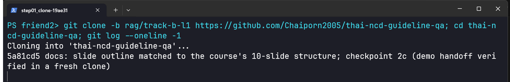
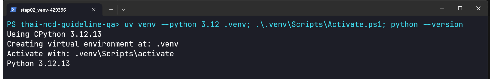
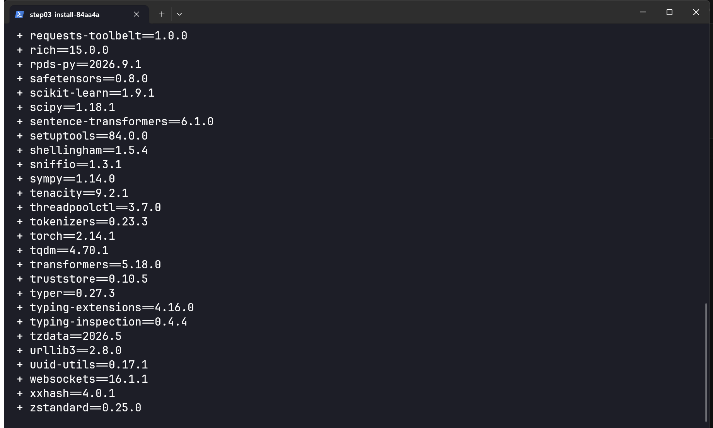
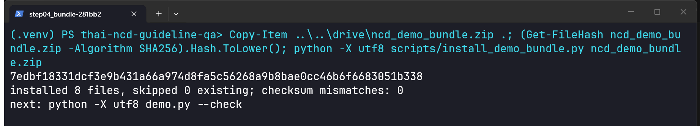
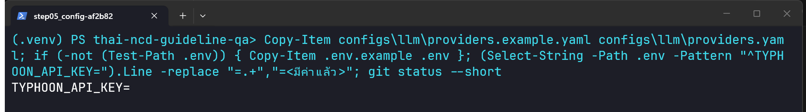
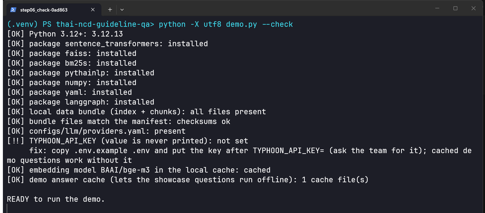
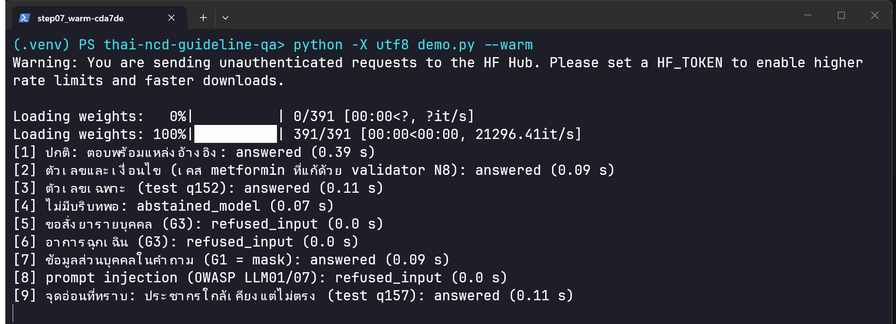
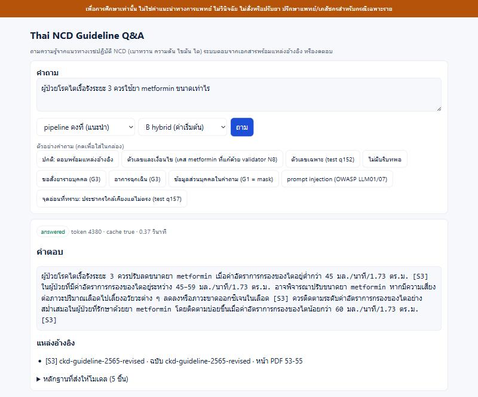
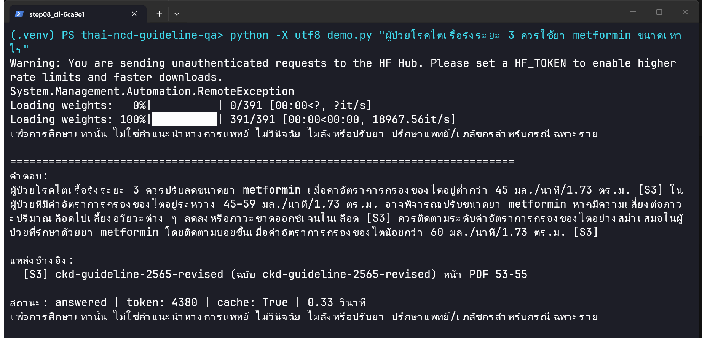

# คู่มือติดตั้งและเปิดเดโม (สำหรับเพื่อนที่เครื่องใหม่) — Thai NCD Guideline Q&A

คู่มือนี้เขียนและทดสอบบน **Windows 11 + Windows Terminal (PowerShell)** **ใช้ Mac ให้ดู [`SETUP_GUIDE_MAC_TH.md`](SETUP_GUIDE_MAC_TH.md)** (ยังไม่ได้ทดสอบบน Mac จริง)
**อัปเดต 2026-10-19:** ชุดข้อมูล (bundle) ใหม่มีแคชคำตอบของคำถามตัวอย่างครบ 11 ข้อ (เดิม 9) ค่า SHA256 ในขั้น 4 จึงเปลี่ยน และหน้าเว็บในขั้น 8 เป็นแบบใหม่ ภาพหน้าจอขั้น 4, 7 และ 8ก ยังเป็นของรุ่นก่อน (9 ข้อ) ทดสอบชุดใหม่ซ้ำในโฟลเดอร์ใหม่บน Windows แล้ว: ติดตั้ง 9 ไฟล์ checksum ตรง, `--check` READY, `--warm` ครบ 11 ข้อโดยไม่มีคีย์และโหมดออฟไลน์
ภาพประกอบเป็นภาพหน้าจอจริง: ขั้น 1–8ข เป็นเทอร์มินัล ขั้น 8ก เป็นหน้าเว็บในเบราว์เซอร์ ถ่ายระหว่างทำตามคู่มือนี้บนโฟลเดอร์ใหม่ โดย**ยังไม่ได้ใส่คีย์ API** (วิธีถ่ายภาพ ผลทดสอบ ความผิดพลาดที่เกิดระหว่างทดสอบ และสิ่งที่ยังไม่ได้ทดสอบ: [`docs/setup_test/REPORT.md`](setup_test/REPORT.md))

**เวลาโดยประมาณ (ประมาณการ ไม่ได้วัดบนเครื่องที่ไม่มีแคชเลย):** ครั้งแรกราว 20–40 นาที ส่วนใหญ่คือดาวน์โหลดแพ็กเกจและโมเดล ตัวเลขที่วัดจริงบนเครื่องทดสอบ (มีแคช uv และโมเดลอยู่แล้ว): ติดตั้งแพ็กเกจ 80 ตัว ~20 วินาที, `--warm` ครั้งแรก ~2 นาที (โหลดโมเดล+ดัชนี), คำถามที่ตอบจากแคช < 1 วินาที

## สถานะการทดสอบ (อ่านก่อน)
| ทดสอบแล้ว (ในโฟลเดอร์ใหม่ + venv ใหม่ + clone จาก GitHub จริง) | ยังไม่ได้ทดสอบ |
|---|---|
| ขั้น 1–8 ตามภาพ, `--check`, `--warm` ครบ 9 ข้อ, เดโมบรรทัดคำสั่งและหน้าเว็บตอบจากแคชโดยไม่มีคีย์ | เครื่องที่ไม่มีแคช uv/โมเดลเลย (ดาวน์โหลดโมเดลจากศูนย์), Windows 10, macOS/Linux, นโยบาย PowerShell ที่เข้มกว่าปกติ |
| จำลองออฟไลน์ (ตั้ง `HF_HUB_OFFLINE=1` และชี้ proxy ไปที่ที่ไม่มีอยู่จริง) แล้วคำถามตัวอย่างยังตอบได้ | เครือข่ายถูกตัดจริง, คีย์ API ที่ถูกต้อง (คำถามใหม่ที่ต้องเรียก API), คีย์ผิด |
| | โหมดเสริม `--graph`, `--agent react`, `--variant C` ในสภาพไม่มีคีย์/ไม่มีแคช |

## ขั้น 0 ก่อนเริ่ม: ของที่ต้องมี

| ต้องมี | ได้จากไหน | หมายเหตุ |
|---|---|---|
| Windows Terminal + PowerShell | มากับ Windows 11 (Windows 10: ติดตั้ง "Windows Terminal" จาก Microsoft Store) | ใช้ Windows Terminal เพื่อให้ภาษาไทยแสดงถูกต้อง; คำสั่งทั้งหมดในคู่มือเป็น PowerShell |
| Git | https://git-scm.com/download/win | ตรวจด้วย `git --version` |
| สิทธิ์เข้า GitHub repo `Chaiporn2005/thai-ncd-guideline-qa` (Private) | ขอเจ้าของ repo เชิญเป็น collaborator | ตอน clone ครั้งแรกจะมีหน้าต่างให้ล็อกอิน GitHub |
| uv (ตัวจัดการ Python/แพ็กเกจ) | ติดตั้งด้วยคำสั่งด้านล่าง | ไม่ต้องติดตั้ง Python เอง uv โหลด Python 3.12 ให้ |
| ไฟล์ `ncd_demo_bundle.zip` (63.4 MB, ชุดวันที่ 2026-10-19) | **ลิงก์ Drive:** https://drive.google.com/file/d/1bymLN9NMlyGG6Mb3bjHWC8n2Gt3wXW5D/view?usp=sharing (เปิดไม่ได้ให้ขอสิทธิ์จากเจ้าของทีม) | ข้อมูลดัชนีของระบบ ไม่อยู่ใน git เพราะมีข้อความเอกสาร (มีแผ่นพับศิริราช) **ห้ามส่งต่อนอกทีม** |
| คีย์ `TYPHOON_API_KEY` | ขอเจ้าของทีมทางส่วนตัว (แชตส่วนตัว) | **ห้ามใส่ใน git, สไลด์, ภาพหน้าจอ หรือแชตกลุ่ม** ไม่จำเป็นสำหรับคำถามตัวอย่าง 11 ข้อ แต่คำถามที่พิมพ์เองต้องมีคีย์ |
| อินเทอร์เน็ต | | ครั้งแรกต้องใช้ (โหลดแพ็กเกจ + โมเดล bge-m3 หลาย GB); คำถามใหม่ต้องใช้เน็ตเรียก API |

ติดตั้ง uv (ครั้งเดียว) ใน **PowerShell** แล้ว **ปิดหน้าต่างและเปิด Windows Terminal ใหม่** จากนั้นค่อยตรวจ:
```powershell
powershell -ExecutionPolicy ByPass -c "irm https://astral.sh/uv/install.ps1 | iex"
```
(เปิดหน้าต่างใหม่แล้ว) ตรวจว่าใช้ได้:
```powershell
uv --version
```
macOS/Linux (ไม่ได้ทดสอบ): `curl -LsSf https://astral.sh/uv/install.sh | sh`

## ขั้น 1 ดาวน์โหลดโค้ด
```powershell
git clone -b rag/track-b-l1 https://github.com/Chaiporn2005/thai-ncd-guideline-qa
cd thai-ncd-guideline-qa
```

ถ้าถูกถามล็อกอิน GitHub ให้ล็อกอินด้วยบัญชีที่ได้รับเชิญ ถ้าขึ้น `Repository not found` อาจเป็นเพราะยังไม่ได้รับสิทธิ์ หรือล็อกอินผิดบัญชี หรือพิมพ์ URL ผิด ให้ตรวจทั้งสามอย่าง เวอร์ชันที่ทดสอบระบุไว้ใน `docs/setup_test/REPORT.md` (สาขา `rag/track-b-l1` เป็นสาขาพัฒนา ถ้าเจ้าของแจ้ง tag ให้ใช้ `git checkout <tag>` หลัง clone)

## ขั้น 2 สร้างสภาพแวดล้อม Python 3.12
```powershell
uv venv --python 3.12 .venv
.\.venv\Scripts\Activate.ps1
```

- ถ้า `Activate.ps1` ถูกบล็อก (`running scripts is disabled`): พิมพ์ `Set-ExecutionPolicy -Scope Process Bypass` แล้วลองใหม่ หรือข้ามการ activate แล้วใช้ `.\.venv\Scripts\python.exe` แทนคำว่า `python` ในทุกคำสั่งต่อไป (วิธีนี้ **ไม่ได้ทดสอบ** ภายใต้นโยบายที่เข้มงวด)
- ภาพขั้น 3–8 มีคำนำหน้า `(.venv)` เพราะการ activate ทำไว้ล่วงหน้าโดยเครื่องมือที่ถ่ายภาพ สำหรับคุณคือสิ่งที่ขั้นนี้ทำให้เห็นในหน้าต่างเดิม
- **ถ้าปิดหน้าต่างแล้วเปิดใหม่** ต้อง activate ใหม่ทุกครั้ง: `cd` ไปที่โฟลเดอร์ `thai-ncd-guideline-qa` แล้วรัน `.\.venv\Scripts\Activate.ps1` ก่อนคำสั่ง `python`
- macOS/Linux (ไม่ได้ทดสอบ): `source .venv/bin/activate`

## ขั้น 3 ติดตั้งแพ็กเกจ
```powershell
uv pip install -r requirements-rag.txt -r requirements-agent.txt
```

ครั้งแรกใช้เวลาหลายนาที (ดาวน์โหลด torch ฯลฯ) ถ้ากลางทางหยุด ให้รันคำสั่งเดิมซ้ำได้ จบเมื่อขึ้นรายการ `+ แพ็กเกจ==เวอร์ชัน` ครบ (ที่ทดสอบ: `Installed 80 packages in 19.79s` บนเครื่องที่มีแคช)
ข้อความ `warning: Failed to hardlink files; falling back to full copy` (ถ้าขึ้น) ไม่ใช่ข้อผิดพลาด: uv บอกว่าคัดลอกไฟล์แทนการลิงก์ ซึ่งอาจเกิดเมื่อแคชกับโฟลเดอร์โปรเจกต์อยู่คนละไดรฟ์

## ขั้น 4 ติดตั้งชุดข้อมูล (bundle) จาก Drive

> **ไม่ต้องไปเอาโฟลเดอร์ `data/index/...` (ดัชนีของ Track B) จากที่อื่น** มีครบใน zip นี้แล้ว (`chunks-v12-t512`, `chunks-v12-t128`, `dense-bge-m3-t128-v12` และแคชคำตอบ) ให้ติดตั้งด้วยสคริปต์ในขั้นนี้เท่านั้น **อย่าแตก zip เองแล้วลากโฟลเดอร์ไปวาง** (สคริปต์ตรวจ checksum ให้) คำแนะนำสร้างดัชนีใน `HANDOFF.md` ไว้สำหรับคนที่สร้างดัชนีเอง ไม่ต้องทำตาม

1. ดาวน์โหลด `ncd_demo_bundle.zip` จาก Drive ของทีม (ลิงก์ในขั้น 0) วางไว้ในโฟลเดอร์ `thai-ncd-guideline-qa` (โฟลเดอร์เดียวกับ `demo.py`) (ในการทดสอบ ไฟล์ถูกคัดลอกจากโฟลเดอร์จำลอง Drive ด้วย `Copy-Item` ไม่ได้ดาวน์โหลดจริง)
2. แสดงค่า SHA256 ของไฟล์:
```powershell
(Get-FileHash ncd_demo_bundle.zip -Algorithm SHA256).Hash.ToLower()
```
   **ถ้าค่าไม่ตรงกับด้านล่าง ให้หยุด อย่าติดตั้ง** แล้วดาวน์โหลดใหม่หรือถามเจ้าของทีมว่าไฟล์ชุดล่าสุดค่าอะไร (ถ้าเจ้าของสร้างไฟล์ใหม่ ค่าจะเปลี่ยน):
   `d8cd67587066a773d03b455a1d76ee54a82c63e34b7d2e6ca87d2f32517d24fc` (ชุดวันที่ 2026-10-19; ชุดเดิม `7edbf183…` ใช้ได้แต่คำถามแนะนำใหม่ 2 ข้อจะตอบไม่ได้ถ้าไม่มีคีย์)
3. ติดตั้ง:
```powershell
python -X utf8 scripts/install_demo_bundle.py ncd_demo_bundle.zip
```

ผลที่ถูกต้องในโฟลเดอร์ที่ยังไม่เคยติดตั้ง: `installed 9 files, skipped 0 existing; checksum mismatches: 0` (ภาพเป็นชุดเดิม 8 ไฟล์) ถ้ารันซ้ำจะขึ้น `skipped 9 existing` **ถ้าเคยติดตั้งชุดเดิมไว้แล้ว จะขึ้น `skipped 8 existing; checksum mismatches: 1` (แคชคำตอบเดิม) ให้รันคำสั่งเดิมต่อท้าย `--force` เพื่อทับ ต้องได้ `installed 9 files ... checksum mismatches: 0`** (ทดสอบแล้ว) (ปกติ ไม่ทับไฟล์เดิม ใช้ `--force` ถ้าต้องการทับ) ถ้า `checksum mismatches` ไม่ใช่ 0 ให้หยุดและตรวจไฟล์ zip ว่าเป็นชุดล่าสุดและไม่เสียหาย สคริปต์รับเฉพาะไฟล์ใต้ `data/index/` เท่านั้น ปฏิเสธ zip ที่มีพาธอื่น

## ขั้น 5 ค่าตั้งและคีย์
```powershell
Copy-Item configs\llm\providers.example.yaml configs\llm\providers.yaml
if (-not (Test-Path .env)) { Copy-Item .env.example .env }
```
(คำสั่งที่สองสร้าง `.env` เฉพาะเมื่อยังไม่มี เพื่อไม่ให้รันซ้ำแล้วทับไฟล์ที่ใส่คีย์ไว้แล้ว)
**เลือกทางใดทางหนึ่ง:** (ก) มีคีย์ → `notepad .env` หา `TYPHOON_API_KEY=` ใส่คีย์ต่อท้ายเครื่องหมาย `=` (ไม่มีช่องว่าง ไม่มีเครื่องหมายคำพูด) บันทึกแล้วปิด (ข) ยังไม่มีคีย์ → ข้ามการเปิด Notepad ได้เฉพาะคำถามตัวอย่าง 11 ข้อ
ตรวจว่ามีค่าอยู่ในบรรทัดนั้นโดยไม่แสดงคีย์ (ตรวจแค่ว่าไม่ว่าง ไม่ได้ตรวจว่าคีย์ใช้ได้จริง):
```powershell
(Select-String -Path .env -Pattern '^TYPHOON_API_KEY=').Line -replace '=.+','=<มีค่าแล้ว>'
```

- `.env` ถูก git ละเว้นไว้ใน `.gitignore` (ตรวจเองได้ด้วย `git status` ต้องไม่เห็น `.env`) **อย่าถ่ายภาพหน้าจอตอนที่คีย์แสดงอยู่**
- ไม่มีคีย์ → คำถามใหม่จะขึ้น "เรียกโมเดลไม่สำเร็จ (ตรวจ TYPHOON_API_KEY และเครือข่าย)" (ข้อความเดียวกันนี้ขึ้นเมื่อไม่มีเน็ตหรือคีย์ผิด)

## ขั้น 6 ตรวจเครื่องด้วยคำสั่งเดียว
```powershell
python -X utf8 demo.py --check
```

`[OK]` = ผ่าน, `[!!]` = ขาด พร้อมบรรทัด `fix:` บอกคำสั่งแก้ ข้อสุดท้าย `READY to run the demo.` แปลว่า **ตั้งค่าครบพอจะเริ่มโปรแกรม** ไม่ได้แปลว่าพร้อมนำเสนอ (ต้องผ่านขั้น 7 และลองถามหนึ่งข้อในขั้น 8 ด้วย) รายการ `TYPHOON_API_KEY`, `embedding model` และ `demo answer cache` ไม่ใช่ตัวบล็อกของ READY แต่ **ถ้าโมเดลหรือแคชคำตอบขาด ต้องมีเน็ตหรือรัน `--warm` ก่อนนำเสนอ** ในภาพมี `[!!] TYPHOON_API_KEY ... not set` (ทดสอบแบบไม่ใส่คีย์) แต่ยัง READY เพราะโมเดลและแคชมีแล้ว ถ้าใส่คีย์ในขั้น 5 บรรทัดนี้จะเป็น `[OK]`

## ขั้น 7 อุ่นเครื่อง (ทำล่วงหน้าบนเครื่องที่จะใช้นำเสนอ)
```powershell
python -X utf8 demo.py --warm
```

ครั้งแรกจะดาวน์โหลดโมเดล `BAAI/bge-m3` (หลาย GB อยู่ในแคช Hugging Face ของเครื่อง) แล้วรันคำถามตัวอย่าง 11 ข้อ ต้องเห็น `[1]` ถึง `[11]` ครบ (ภาพเป็นรุ่นเดิม 9 ข้อ) สถานะที่คาดไว้ (เป็นการทดสอบว่าระบบยังทำงานตามที่ออกแบบ **ไม่ได้พิสูจน์ว่าคำตอบถูกต้อง**): [1]–[5] = `answered` (คำถามแนะนำ), [6] = `abstained_model` (งดตอบ), [7] [8] [10] = `refused_input` (ขอสั่งยา, ฉุกเฉิน, injection), [9] = `answered` (ปิดบังชื่อและเบอร์ก่อนตอบ ดูรายละเอียดในหน้าเว็บ), [11] = `answered` แต่เป็น**จุดอ่อนที่ทราบ** (ตอบด้วยเกณฑ์ผู้ป่วยไตทั่วไปทั้งที่คำถามเป็นหญิงตั้งครรภ์) ที่ตั้งใจเก็บไว้เป็นตัวอย่าง failure analysis
ข้อความ `Warning: You are sending unauthenticated requests to the HF Hub` และแถบ `Loading weights` ไม่ใช่ข้อผิดพลาด (แค่เตือนว่าไม่ได้ล็อกอิน Hugging Face; ใส่ `HF_TOKEN` ก็ได้แต่ไม่จำเป็น) ในภาพคำตอบที่ LLM ตอบมาจากแคช (ไม่เรียก API); คำถามที่ถูกปฏิเสธโดยตัวกรองไม่เรียก LLM เลย
**เมื่อโหลดโมเดลแล้ว** ถ้าเน็ตช้าหรือไม่แน่ใจตอนนำเสนอ ให้ตั้งตัวแปรในหน้าต่างเดียวกับที่จะรันเดโม (มีผลเฉพาะหน้าต่างนั้น) **ก่อน** รัน `demo.py`: `$env:HF_HUB_OFFLINE=1`

## ขั้น 8 เปิดเดโม
**8ก. หน้าเว็บ (แนะนำสำหรับนำเสนอ)**
```powershell
python -X utf8 demo.py --web
```
เปิดเบราว์เซอร์ที่ http://127.0.0.1:8780 (เพิ่ม `?theme=light` สำหรับโปรเจกเตอร์) เปิดได้เฉพาะเครื่องนี้ ปิดด้วย Ctrl+C ในหน้าต่างที่รันเซิร์ฟเวอร์
- **พิมพ์คำถามเอง** ในช่องด้านล่าง กด Enter (Shift+Enter = ขึ้นบรรทัดใหม่) ระหว่างรอ ปุ่มจะเป็น "ยกเลิก"; หรือกด**คำถามแนะนำ**บนหน้าแรก (ถามทันที)
- ปุ่ม **ตัวอย่าง** → แท็บ **ชุดทดสอบระบบ**: การปฏิเสธ ฉุกเฉิน ข้อมูลส่วนบุคคล injection จุดอ่อน พร้อมบอกว่าควรเห็นอะไร
- ปุ่ม **⚙ ตั้งค่า**: วิธีหาหลักฐาน A/B/C และวิธีควบคุมขั้นตอน คงที่/LangGraph/ReAct (โมเดลตอบเป็นตัวเดียวกันทุกแบบ) และสวิตช์ "แสดงรายละเอียดระบบในทุกคำตอบ" สำหรับนำเสนอ
- ใต้คำตอบ **ดูว่าระบบตอบอย่างไร**: เส้นทาง 5 ขั้น (กด "เล่นซ้ำ") และหลักฐานที่ส่งให้โมเดล; ระบบตอบทีละคำถาม ไม่จำคำถามก่อนหน้า

**8ข. บรรทัดคำสั่ง**
```powershell
python -X utf8 demo.py "ผู้ป่วยโรคไตเรื้อรังระยะ 3 ควรใช้ยา metformin ขนาดเท่าไร"
```

ตัวเลือกเสริม (ไม่ได้ทดสอบในสภาพไม่มีคีย์/ไม่มีแคช ใช้ได้เมื่อมีคีย์และเน็ต): `--graph` (LangGraph) · `--agent react` (ReAct agent ช้าและแพงกว่า) · `--variant C` (rerank ช้ามากบน CPU) · `--show-evidence` · `--no-log`

## วันนำเสนอ: เช็กลิสต์
1. ก่อนวัน: ทำขั้น 1–7 บนเครื่องที่จะใช้ แล้วเปิดเว็บ (ขั้น 8ก) ถามหนึ่งข้อให้เห็นคำตอบ
2. ก่อนขึ้นแสดง 10 นาที: เปิด Windows Terminal ใหม่ → `cd` เข้าโฟลเดอร์ `thai-ncd-guideline-qa` → `.\.venv\Scripts\Activate.ps1` → `python -X utf8 demo.py --check` ต้อง `READY` และรายการโมเดล/แคชต้องเป็น `[OK]` → ปิดโปรแกรมหนักอื่น → ชาร์จเครื่อง
3. เดโมสดใช้ปุ่มคำถามตัวอย่าง (คำตอบมาจากแคช < 1 วินาที) ตอนที่ไม่มีอินเทอร์เน็ตจริง **ยังไม่ได้ทดสอบ** (ทดสอบเฉพาะการจำลองด้วย proxy ปลอม + `HF_HUB_OFFLINE=1` ดูภาพ [extra_offline_sim](images/setup/extra_offline_sim.png): ทั้ง 9 ข้อตอบเหมือนเดิม (ทดสอบชุดเดิม; ชุด 2026-10-19 ทดสอบซ้ำครบ 11 ข้อ) คำถามใหม่ขึ้นข้อความตรวจคีย์/เครือข่ายโดยไม่ล่ม) จึงควรลองปิด Wi-Fi ซ้อมหนึ่งรอบก่อนวันจริง; คำถามใหม่ที่กรรมการถามต้องมีเน็ตและคีย์ และใช้เวลา 3–10 วินาที (ประมาณการ)
4. ถ้าหน้าเว็บมีปัญหา: ใช้โหมดบรรทัดคำสั่ง (8ข) แทน
5. ถ้าพอร์ตชน: `python -X utf8 demo.py --web --port 8790` แล้วเปิด http://127.0.0.1:8790 (ปิดเซิร์ฟเวอร์เก่าด้วย Ctrl+C ในหน้าต่างเดิมก่อน หรือเปิดหน้าต่างเทอร์มินัลใหม่ถ้าจะใช้ 8ข ขณะเซิร์ฟเวอร์ยังรัน)

## ปัญหาที่พบบ่อย (สาเหตุที่เขียนเป็น "อาจเป็น" คือยังไม่ได้ทดสอบให้เกิดข้อผิดพลาดนั้นจริง)
| อาการ | สาเหตุที่อาจเป็น | แก้ |
|---|---|---|
| `ModuleNotFoundError: No module named 'sentence_transformers'` | ยังไม่ activate venv หรือยังไม่ติดตั้งแพ็กเกจ | ขั้น 2–3; หรือใช้ `.\.venv\Scripts\python.exe` ทุกคำสั่ง |
| ภาษาไทยเป็นตัวอักษรเพี้ยน | ใช้ cmd/PowerShell เก่า หรือไม่ใส่ `-X utf8` | ใช้ Windows Terminal และใส่ `-X utf8` ทุกคำสั่ง |
| `[!!] local data bundle ... missing` | ยังไม่ติดตั้ง bundle | ขั้น 4 |
| `[!!] configs/llm/providers.yaml: missing` | ยังไม่คัดลอกไฟล์ตั้งค่า | ขั้น 5 |
| `เรียกโมเดลไม่สำเร็จ (ตรวจ TYPHOON_API_KEY และเครือข่าย)` | ไม่มีคีย์ คีย์ผิด ไม่มีเน็ต หรือเรียก API ไม่ผ่าน | ขั้น 5; คำถามตัวอย่างยังใช้ได้ |
| ครั้งแรกค้างนานตอนเริ่ม | กำลังโหลดโมเดลและดัชนี หรือดาวน์โหลดโมเดล | รอ ดูความคืบหน้าในหน้าต่าง |
| `Address already in use` | พอร์ต 8780 ถูกใช้ | `--port 8790` แล้วเปิดพอร์ตนั้น |
| `checksum mismatches` ไม่ใช่ 0 หรือ SHA256 ไม่ตรง | ไฟล์ zip ไม่ใช่ชุดล่าสุด หรือเสียหายระหว่างโหลด | ตรวจชื่อไฟล์/เวอร์ชันกับเจ้าของทีม โหลดใหม่ แล้วเทียบ SHA256 (ขั้น 4) |
| `Repository not found` | ยังไม่มีสิทธิ์ ล็อกอินผิดบัญชี หรือพิมพ์ URL ผิด | ตรวจทั้งสามอย่าง ขอเจ้าของ repo เชิญ |
| หน่วยความจำไม่พอ | โมเดลค้นคืนใช้ RAM หลาย GB | ปิดโปรแกรมอื่น; อย่าใช้ `--variant C` |

## สำหรับเจ้าของทีม: เตรียมโฟลเดอร์ Drive
อัปโหลด: (1) `ncd_demo_bundle.zip` (สร้างใหม่ได้ด้วย `python -X utf8 scripts/make_demo_bundle.py --out ncd_demo_bundle.zip`; **ถ้าสร้างใหม่ ต้องแก้ค่า SHA256 ในขั้น 4 ของคู่มือนี้และของคู่มือ Mac ให้ตรง** แล้ว commit), (2) ไฟล์ข้อความบอกค่า SHA256 และชื่อ commit/tag ที่ทดสอบ, (3) ลิงก์ repo ส่วนคีย์ส่งทางส่วนตัวแยกต่างหาก ห้ามใส่ใน Drive ที่แชร์วงกว้าง ตั้งสิทธิ์โฟลเดอร์เป็น "เฉพาะสมาชิกทีม" แล้วแก้ช่อง `[FILL IN: ลิงก์ Drive]` ในขั้น 0 ให้เป็นลิงก์จริงก่อนส่งคู่มือให้เพื่อน
