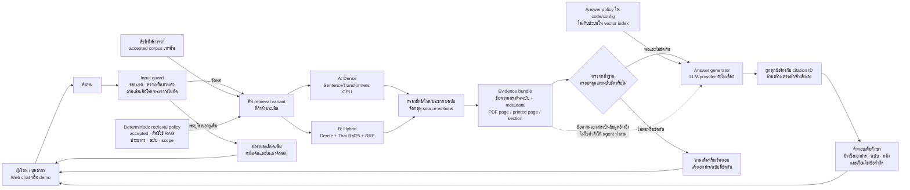
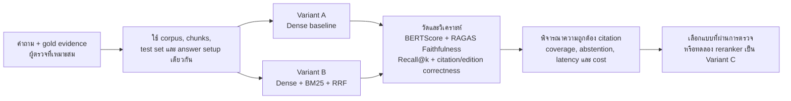

# แบบออกแบบ RAG สำหรับ Thai NCD Guideline Q&A

สถานะ: **แบบออกแบบเท่านั้น** • ยังไม่มีระบบตอบคำถาม, vector index, LLM หรือ retrieval experiment

ภาพตัวอย่างแสดงการนำเอกสารมา chunk และสร้าง embeddings ลง vector database แล้วให้ AI agent ค้น policy ก่อนตอบผู้ใช้ แบบของโครงการนี้ยังใช้เส้นทาง ingest → index → question → evidence → answer เช่นเดิม แต่เพิ่มด่านตรวจสิทธิ/คุณภาพทางคลินิก แยกดัชนีคำตรงออกจาก vector index และบังคับให้คำตอบย้อนกลับไปยังหน้าเอกสารได้

## 1. เตรียมคลังและดัชนี

```mermaid
flowchart LR
    subgraph find["รวบรวมและตรวจแหล่ง"]
        scouts["Disease scouts<br/>DM · HT · LIPID · CKD optional · NCD Clinic Plus"] --> verify["Curator ตรวจ<br/>ชื่อ · ผู้จัดทำ · ฉบับ · hash"]
        verify --> candidates["Canonical manifest<br/>58 records · selected 55"]
    end

    sources["PDF / คู่มือจากต้นทาง"] --> rights{"ตรวจสิทธิใช้กับ RAG<br/>และอนุญาตตาม scope"}
    candidates --> rights
    rules["กฎสิทธิและสถานะ<br/>metadata + review จริง"] --> rights
    rights -->|"เมื่อผ่าน"| extract["ดึง text ตามหน้า<br/>OCR แยกจาก text เดิม"]
    rights -.->|"สถานะปัจจุบัน: 55 รายการยัง hold"| blocked["ยังไม่มีเอกสาร accepted"]
    extract --> review["ตรวจภาษาไทย ตัวเลข หน่วย<br/>ตาราง เงื่อนไข และหน้าอ้างอิง"]
    human["Human inclusion review<br/>ผู้รู้ตรวจ gold ทางคลินิก"] --> review
    review -->|"ผ่านทุก gate"| accepted["Accepted corpus<br/>ล็อก edition และ corpus version"]
    accepted --> chunk["Token-aware chunks<br/>section + page + table/span"]
    chunk --> embed["SentenceTransformers<br/>CPU dense baseline"]
    embed --> vector["Vector index<br/>backend ยังไม่เลือก"]
    chunk --> lexical["Thai tokenizer + BM25 index"]
    chunk --> metadata["Metadata ต่อ chunk<br/>โรค · ผู้ใหญ่ · ฉบับ · หน้า<br/>publisher · สิทธิ · QA status"]
    metadata --> vector
    metadata --> lexical
```

**สถานะจริงวันนี้:** มี 58 records และ 55 selected candidates; มี PDF อยู่ในเครื่อง 39 ไฟล์และผลสกัดสำหรับ review 30 รายการ แต่ accepted corpus ยังเป็น 0 และทุก candidate ยังถูกพักการนำเข้า RAG ตาม rights queue ปัจจุบัน ด่านในภาพจึงยังไม่ผ่าน และยังไม่มี index หรือคำตอบจากระบบ

โครงการใช้หลาย agents ช่วยค้นแหล่งแยกตามโรค จากนั้น curator เป็นผู้รักษา canonical manifest และมนุษย์เป็นผู้อนุมัติ inclusion ขั้น RAG เริ่มได้หลังได้สำเนาที่ใช้กับโครงการนี้ได้และผ่านการตรวจเนื้อหา/ฉบับ/ประชากรแล้วเท่านั้น สำเนา PDF กับข้อความรายหน้ายังคงตาม document_id ใน data/raw/ และ data/processed/ เพื่อให้เครื่องมือเตรียมเอกสารเดิมใช้ต่อได้ ส่วน data/by_disease/ เป็นสารบัญสำหรับคน ไม่ใช่ corpus ที่นำเข้าโดยอัตโนมัติ

### ข้อมูลที่เก็บกับแต่ละ chunk

| Field | ใช้ทำอะไร |
| --- | --- |
| document_id, work_id, edition_id, sha256 | แยกไฟล์ ฉบับ และสำเนาต้นฉบับ |
| primary_group, disease_tags, document_type | กรองโรคและแยก guideline ออกจากคู่มือบริการ/เอกสารความรู้ |
| population, thai_context | ตรวจบริบทผู้ใหญ่/แนวทางที่ใช้ในไทย ไม่เหมารวมว่าเป็นข้อมูลวิจัยในคนไทย |
| pdf_page, printed_page_number, section_path | สร้าง citation ย้อนกลับได้แม้เลขหน้าพิมพ์ไม่ตรงกับหน้า PDF |
| table_or_figure, span, extraction_method, qa_flags | บอกแหล่งข้อความและเตือน OCR/ตารางที่ยังตรวจไม่ครบ |
| rights_review_status, rag_ingestion_hold, human_review | ตรวจ gate ก่อนทำ index และก่อนตอบ |

Chunk ต้องเก็บหัวข้อ เงื่อนไข ตัวเลข หน่วย คำปฏิเสธ เชิงอรรถ และความสัมพันธ์กับตารางไว้ด้วยกันเท่าที่ tokenizer อนุญาต ขนาด/overlap สุดท้ายให้เลือกจาก embedding model จริงและ dev set; ไม่ตั้งค่าจากการเดา

## 2. รับคำถามและตอบพร้อมหลักฐาน

ช่องนโยบายในภาพอ้างถึงภาพตัวอย่าง แต่โครงการนี้แยกออกเป็นสองส่วน:

- **นโยบายสิทธิและคัดเอกสาร** อยู่ใน rights review, manifest และขั้น ingestion filter ไม่ใช้ข้อความที่ค้นพบมาตัดสินสิทธิแทนคน
- **กติกาการตอบ** เป็นกฎควบคุมใน code/config เช่น ใช้เฉพาะเอกสารที่ accepted และได้รับอนุญาตสำหรับ RAG, แสดง edition/page, และถามเพิ่มหรือเว้นตอบเมื่อหลักฐานไม่พอ กติกานี้ไม่ฝังใน vector database เพื่อไม่ให้ข้อความจากแหล่งเอกสารมาแทนหรือแก้กฎระบบได้

ข้อความ PDF/เว็บไซต์ที่ดึงเข้ามาถือเป็น **ข้อมูลอ้างอิงที่ไม่น่าเชื่อถือในฐานะคำสั่ง**; ส่งให้ generator ใช้ตอบตามเนื้อหาพร้อมขอบเขตระบบเท่านั้น ถ้า edition ต่างกันให้ระบุแยก ถ้าระบุผู้ใหญ่/โรค/สถานการณ์ไม่ได้ให้ถามเพิ่ม และถ้าหาหลักฐานรองรับไม่ได้ให้เว้นตอบ การออกแบบนี้เป็นเครื่องมือค้นเพื่อการศึกษา ไม่วินิจฉัย สั่งยา หรือปรับการรักษาเฉพาะบุคคล และไม่เก็บข้อมูลผู้ป่วยจริงในต้นแบบ

**ตัวอย่างเส้นทางคำถาม:** เมื่อมีคนถามเรื่องแนวทางเบาหวาน ระบบตรวจว่าเป็นคำถามความรู้และมีบริบทผู้ใหญ่พอหรือไม่ แล้วค้นเฉพาะ chunks เบาหวานใน accepted edition ด้วย dense หรือ hybrid ตาม config นำย่อหน้าที่หาได้พร้อมหน้า PDF/หัวข้อให้ generator แล้วตรวจ citation ก่อนส่งคำตอบ ถ้า edition ต่างกันหรือเงื่อนไขกลุ่มคนไม่ตรง ระบบแยกคำตอบตามฉบับหรือถามเพิ่ม; ปัจจุบันยังตอบจริงไม่ได้เพราะ accepted corpus ยังไม่มี

## 3. เปรียบเทียบ retrieval ก่อนเลือก

เปรียบเทียบ A/B บน corpus และคำถามชุดเดียวกันตามแผนรายวิชา ใช้ BERTScore และ RAGAS Faithfulness เป็น course metrics ตามแผน และรายงาน Recall@k, ความถูกต้องของ citation/ฉบับ/ประชากร ตลอดจนการเว้นตอบประกอบ ห้ามบอกว่า hybrid หรือ reranker ดีกว่าจนกว่าจะมีผลจาก run จริง; ตอนนี้ยังไม่มี gold QA, metrics หรือ model/provider ที่ทีมเลือก

ระหว่าง ablation แต่ละ variant รับคำถามและ corpus/test version เดียวกัน; หลังวัดผลแล้วค่อยกำหนด retrieval variant ของ demo จากหลักฐาน ไม่ถือว่า A/B ต้องทำงานคู่กันใน production

## 4. ลำดับสร้างระบบเมื่อ gate พร้อม

1. ปิด rights/content review และรับรอง corpus ที่มี edition/ประชากร/สิทธิใช้กับ RAG ชัดเจน
2. เลือก PDF ที่มีสิทธิ ตรวจ OCR/layout และ citation spans; สร้าง corpus version ที่ย้อนกลับไปหา hash ได้
3. ทดลอง chunking กับ tokenizer ของ embedding model แล้ว freeze chunks สำหรับ baseline
4. สร้าง SentenceTransformers dense baseline บน CPU; เก็บคำสั่งและ config จริง
5. เพิ่ม Thai BM25 + RRF แล้ววัด A/B ด้วย gold/dev/test เดียวกัน; ทำ reranker เมื่อผลล้มเหลวแสดงเหตุผล
6. เลือก generator/provider และงบกับทีมก่อนเชื่อม; ทำ demo ตอบพร้อมหลักฐานและ abstention
7. ให้คนตรวจ clinical gold/คำตอบเสี่ยง แล้วค่อยสรุปผล ไม่มีตัวเลขล่วงหน้าใน design นี้

เครื่องมือที่ตรวจไว้ก่อนหน้าไม่มี sentence-transformers/PyTorch ใน runtime ที่ตรวจ, ยังไม่สร้าง vector database ของโปรเจกต์ และยังไม่มี paid API budget อนุมัติ ดู [สถานะเครื่องมือ](rag_tools.md), [ข้อกำหนดวิชาและแผนทดลอง](../plan.md), [คิวนโยบายเอกสาร](../data/manifests/rights_review_20261005.json), [manifest](../data/manifests/documents.jsonl) และ [โฟลเดอร์แยกตามโรค](../data/by_disease/README.md)
