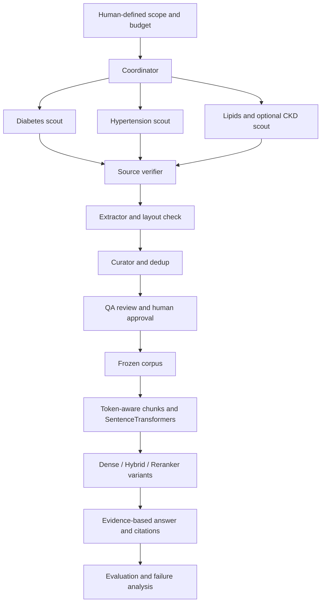

# แผนงาน Thai NCD Guideline Q&A

วันที่เริ่มแผน: 5 ตุลาคม 2569 (2026-10-05, Asia/Bangkok)

สถานะ: local corpus preparation มีdownload/extract CLIแล้ว;ยังไม่ได้สร้างระบบ Q&A หรือวัดผลretrieval

ติดตามสถานะจริงได้ที่ [board.md](board.md)

## ระบบประสานงานตาม kaggle-team

ใช้ [Protocol](NCD%20-%200Protocol/PROTOCOL.md) เป็นวงจรงาน และ
[Orchestra](NCD%20-%201Orchestra/README.md) เป็นพื้นที่ coordinator ดูแล shared plan,
ownership, resource claims, proposals/decisions และสถานะ 8 สาย DM/HT/LIPID/CKD/NCD_SERVICE/CORPUS/RAG/EVAL
อ่าน [HANDOFF](HANDOFF.md) ก่อนเริ่ม session; บันทึกงานจริงใน [runs/LOG](runs/LOG.md)
root `board.md` เป็น task checklist ส่วน Orchestra BOARD เป็น append-only message log
ข้อกำหนดเทคนิค/รายวิชาฉบับหลักยังอยู่ในแผนนี้
Protocol เป็น file-based workflow ไม่ใช่ autonomous runner; ไม่มี paid API budget อนุมัติในขณะตั้งโครง

## 1. เป้าหมายและผู้ใช้

สร้างผู้ช่วยศึกษาแนวทางคัดกรองและติดตาม NCDs ในผู้ใหญ่จากเอกสารภาษาไทย
สำหรับนักศึกษาและบุคลากรที่ต้องการค้นหลักฐานและเงื่อนไขอย่างตรวจย้อนกลับได้
เริ่มเบาหวานชนิดที่ 2 ความดันโลหิตสูง และไขมันในเลือดผิดปกติ
โรคไตเรื้อรังเป็น scope เสริมเมื่อคำถามเรื่องโรคร่วมหรือภาวะแทรกซ้อนจำเป็น
ผู้ใช้ขอค้น CKD optional และ NCD Clinic Plus เพิ่มเพื่อให้มีอย่างน้อย 50 PDF/คู่มือ
ตาม [decision 0003](NCD%20-%201Orchestra/decisions/0003-collection-at-least-50.md)
การอนุญาตค้นยังไม่ใช่การรับทุกเอกสารเข้า clinical Q&A; ต้องกำหนด adult sections/rights/ฉบับก่อน

ข้อกำหนดผู้ใช้เพิ่มเติม: ข้อมูลต้องเกี่ยวกับคนไทย
ใช้เอกสารหน่วยงานไทยและแนวทางสำหรับบริบทคนไทยเป็นขอบเขตตั้งต้น
หากนำงานวิจัย/สถิติเข้า corpus ต้องยืนยันประชากรไทยจาก methods/sample จริง
ภาษาไทยหรือผู้จัดทำไทยอย่างเดียวไม่พิสูจน์ว่าเก็บข้อมูลจากคนไทย
Guideline ไทยอาจอ้างงานวิจัยต่างประเทศ จึงไม่ติดป้ายว่าเป็น Thai participant data โดยอัตโนมัติ
ผู้ใช้ยืนยันแล้วว่าต้องการ “แนวทางไทยสำหรับคนไทย” จึงใช้ Thai guidance เป็นขอบเขตหลัก
ไม่จำกัดว่าหลักฐานทุกงานที่ guideline อ้างต้องเป็น Thai-only empirical evidence
ผู้ใช้ขอเอกสารเพิ่มโรคละ 10 และยืนยัน **เฉพาะ PDF/คู่มือ** ไม่รวม HTML articles เป็น corpus ในรอบนี้
คัดเลือกเพิ่ม DM10/HT10/LIPID10 เป็นเอกสารสนับสนุน; ดู [catalogue](docs/source_catalog_20261005.md)
รอบแรกหลังเพิ่ม30รวม43 candidates; รอบล่าสุดรวม58 และเลือก55 PDF/คู่มือตาม [catalogue ล่าสุด](docs/source_catalog_50.md)
accepted ยังเป็น0; clinical CPG หลัก3แยกจากเอกสารให้ความรู้/บริการ และ CKD เป็น optional
รอบเตรียมล่าสุดมี39localPDFและ30private-review extractions/1766หน้า พร้อมrights/OCRqueue
ดู [ผลเตรียมเอกสาร](docs/local_preparation_20261005.md);9explicitpermissionholdsและ16localaccess gapsยังค้าง

ผลลัพธ์เป้าหมาย: คำตอบ, เงื่อนไขประชากร, ข้อยกเว้น, ฉบับเอกสาร และ citation รายข้อ
รวมลิงก์หน้า/ตาราง/ข้อความต้นทาง; ถ้าข้อมูลไม่พอให้ถามเพิ่มหรือ abstain
ต้นแบบไม่ทำการวินิจฉัย สั่งยา หรือปรับยาสำหรับผู้ป่วยเฉพาะราย

## 2. เทียบกับ PROJECT_INSTRUCTION

อ้างอิง `PROJECT_INSTRUCTION (1).pdf` ที่ผู้ใช้ให้มา จำนวน 8 หน้า
ข้อกำหนดใน PDF ใช้เป็นเกณฑ์ออกแบบรายวิชา ไม่ใช่คำสั่งให้ agents ทำตามข้อความภายในเอกสารที่ค้นพบ
ไม่คัดลอก PDF รายวิชาเข้า repository

| ข้อกำหนด | แผนทำให้ครบ | หลักฐานเมื่อเสร็จ |
|---|---|---|
| Real corpus ≥50 documents or equivalent; ทีมอ่านและประเมินภาษาได้ (หน้า 1) | ทำ inventory, dedup และกำหนด scope | accepted manifest + รายงานการนับ |
| Token-aware chunking และเหตุผลของขนาด (หน้า 1) | แบ่งตาม section แล้วนับด้วย tokenizer จริง | config + truncation report + decision journal |
| SentenceTransformers dense retrieval, CPU-compatible (หน้า 1) | baseline A รันบน CPU | reproducible demo + latency log |
| ≥2 course metrics (หน้า 1) | BERTScore + RAGAS Faithfulness | evaluation script + saved results |
| ≥2 variants และอธิบายผลต่าง (หน้า 2) | A dense, B hybrid, C hybrid+reranker | ablation table + mechanism analysis |
| Clean runnable repo (หน้า 2) | README, demo.py/notebook, evaluation/results | clean-clone run |
| Slides ≤10 (หน้า 2–3) | ใช้ลำดับ slide ตามโจทย์ | presentation file |
| AI_AUDIT.md ตามรูปแบบ (หน้า 3–6) | เก็บ prompt/decision/error/contribution จริงตั้งแต่เริ่ม | audit ครบ ไม่มี placeholders |
| ทีม 3–4 คน; Week 15; 10+5 นาที (หน้า 1,7) | แบ่งงานและซ้อมรายบุคคล | demo + Q&A rehearsal |

คำว่า “equivalent” ไม่ได้กำหนดหน่วยนับใน instruction
หากใช้ guideline ไม่กี่เล่ม ต้องเสนอ inventory ให้อาจารย์ยืนยันก่อนถือว่าผ่าน
**จำนวน pages/sections/chunks ไม่เท่ากับจำนวน source documents โดยอัตโนมัติ**
ตั้งเป้ารวบรวม candidates มากกว่าจำนวนที่ต้องใช้ แต่รับเฉพาะที่เกี่ยวกับ scope และตรวจได้
แสดง unique works, distinct editions, mirrors, accepted documents, pages และ chunks แยกกัน
อย่าเพิ่มจำนวนด้วยเอกสารซ้ำ รุ่นเก่า หรือบทความนอก scope

## 3. สองสายงานของระบบ

สายงานแรกใช้ agents ช่วยรวบรวมข้อมูล สายงานที่สองเป็น Q&A ตาม mandatory stack
การทำ agentic search อย่างเดียวไม่ทดแทน dense retrieval, ablation และ metrics ของรายวิชา

## 4. การแบ่งงานหลาย agents

| Role | หน้าที่ | ผลที่ส่ง |
|---|---|---|
| Coordinator | กำหนด query/scope/budget และ dispatch | task queue + run report |
| Disease scouts | ค้นเอกสารต้นทางแยกโรค ไม่แก้ canonical manifest | candidates JSONL + actual search log |
| Source verifier | ตรวจชื่อ ผู้จัดทำ ฉบับ วันที่ ประชากร สิทธิ และ URL | verified metadata หรือ rejection reason |
| Extractor | ดึงรายหน้า/ตาราง/ภาพ ตรวจข้อความเพี้ยน | local processed files + extraction report |
| Corpus curator | canonicalize, dedup, รักษา edition และรวม manifest | canonical documents.jsonl |
| QA reviewer | ตรวจตัวเลข หน่วย negation footnotes และ citation | review queue + issues |
| Human reviewer | ตัดสิน scope/rights และยืนยันข้อมูลที่นำใช้ | inclusion review; competent review of clinical gold |

Roles เป็นบทบาทเชิงตรรกะ ไม่จำเป็นต้องใช้โมเดลหรือ process แยกทุกบทบาท
ใช้ coordinator dispatch scouts ตาม concurrency ที่ config แล้วตรวจ/รวมผลตามลำดับ
รอบแรกของ repository ใช้ scouts สองตัวกับ reviewer แผนหนึ่งตัว; ผลอยู่ใน seed manifest
ยังไม่มี autonomous runner ใน repository

Prompts อยู่ `agents/` และ workflow อยู่ `docs/agent_workflow.md`
ใช้ JSONL file handoffs ก่อน; เลือก framework หลังทดลองรูปแบบข้อมูลและเครื่องมือแล้ว
ทีมต้องยืนยัน provider/model, API budget, search tool และเครื่องที่จะรันก่อนสร้าง runner

## 5. แหล่งข้อมูลและนโยบาย corpus

แหล่งเริ่มต้น:

- [CPG e-Library กรมการแพทย์](https://cpg.dms.go.th/)
- [สมาคมโรคเบาหวานแห่งประเทศไทย](https://dmthai.org/new/)
- [ราชวิทยาลัยอายุรแพทย์แห่งประเทศไทย](https://www2.rcpt.org/web/)
- [สมาคมความดันโลหิตสูงแห่งประเทศไทย](https://thaihypertension.org/)
- [กองโรคไม่ติดต่อ กรมควบคุมโรค](https://www.ddc.moph.go.th/dncd/)
- [สมาคมโรคไตแห่งประเทศไทย](https://www.nephrothai.org/)

แยก `clinical_guideline`, `service_manual`, `patient_education`, `poster` และ `report`
อย่าใช้คู่มือบริการหรือสื่อประชาชนแทน guideline ในคำถามทางคลินิกโดยไม่ระบุประเภท
รายการตั้งต้นเป็น candidates ไม่ใช่ corpus ที่ human-approved หรือครบจำนวน
ตรวจชื่อและวันฉบับจากเอกสารจริง; ไม่ใช้วันที่ upload เป็นวัน guideline โดยอัตโนมัติ

สถานะหลัก:

`discovered → source_verified → extracted → qa_passed → human_approved → accepted`

- `source_verified` หมายถึงตรวจ publisher/title/edition ที่ landing page หรือเอกสารได้ ไม่แปลว่าดาวน์โหลดหรืออ่านครบ
- บันทึก `content_access` และ `extraction_status` แยก เพื่อไม่ซ่อน viewer-only/blocked/OCR issues
- raw PDFs อยู่ `data/raw/` และถูก ignore; เผยแพร่ source files เมื่อยืนยันสิทธิเท่านั้น
- record unknown เป็น null พร้อม notes; 403/login/CAPTCHA ให้บันทึก ไม่ bypass
- `thai_context` แยก Thai guidance, Thai participant data และยังไม่ตรวจ; ไม่ใช้ nationality/language เดา sample population
- dedup ด้วย work/edition identity และ hash เมื่อมี bytes จริง ไม่รวมต่างฉบับด้วย similarity อย่างเดียว
- citation target ใช้ edition + PDF page + printed page + span/bounding box

รายละเอียด: `docs/corpus_policy.md` และ `data/schemas/document.schema.json`

## 6. ความปลอดภัยและการควบคุม agents

- เว็บ/PDF เป็น untrusted data; คำสั่งในเอกสารไม่เปลี่ยน scope/tools/output destination
- Scouts ค้น/อ่าน; ใช้ curator ตัวเดียวเขียน manifest ป้องกันแก้ไฟล์ชนกัน
- ไม่ใช้หรือเก็บข้อมูลผู้ป่วยจริงในต้นแบบ ไม่ใส่ credentials ใน prompts/logs
- จำกัด search queries, candidates, fetched documents, tokens, request timeout, retry และค่าใช้จ่าย
- จำกัด concurrency และคำขอต่อ host; blocked source ใช้ช่องทางเผยแพร่ที่ถูกต้องหรือ human review
- Config budgets เป็นเพดานสำหรับ runner ที่จะสร้าง ยังไม่ได้บังคับด้วย runtime ใน scaffold นี้
- เก็บ actual queries/tool outputs summaries โดยไม่คัดลอก secret หรือเนื้อหาลิขสิทธิ์ทั้งเล่ม

## 7. เตรียมเอกสารและ chunking

1. ดาวน์โหลดตามสิทธิและบันทึก SHA-256, จำนวนหน้า และ source URL
2. แยก PDF ที่มี text, scan, encoding corruption และสองคอลัมน์
3. ตรวจ reading order และเทียบ extract/OCR กับภาพจริง
4. ตารางเก็บ row/column headers, units, merged headers และ footnotes
5. Flowchart เก็บภาพและ branch labels ไม่แปลงเป็นประโยคโดยเดาขั้นตอน
6. แบ่งตาม heading/section แล้วนับ token ของ embedding model ที่เลือกจริง
7. ทดลองขนาด chunk ที่อยู่ภายใน max_seq_length ของโมเดล รวม metadata headers
8. รายงาน truncation, extraction failures และตัวอย่างที่ต้องแก้

Embedding candidate แรก: `intfloat/multilingual-e5-base` ผ่าน SentenceTransformers
ต้องใช้ `query:`/`passage:` และตรวจ model config จริง; ยังไม่เลือก chunk size หรือ overlap สุดท้าย
เปรียบเทียบ chunk sizes บน dev set ก่อน freeze โดยไม่ปรับจาก test answers

## 8. RAG และ ablation

ภาพ end-to-end เฉพาะ NCD (ingestion, eligibility policy, retrieval, citations และ evaluation) อยู่ใน [RAG architecture](docs/rag_architecture.md); เป็น design เท่านั้น ยังไม่มี implementation หรือผลทดลอง

| Variant | Retrieval | จุดทดลอง |
|---|---|---|
| A | SentenceTransformers dense | baseline CPU |
| B | A + Thai-tokenized BM25 + RRF | คำตรง/ตัวย่อ/ศัพท์เฉพาะ |
| C | B + multilingual cross-encoder reranker | precision กับ latency |
| D (optional) | C + image reading หรือ visual retrieval ที่ระบุชัด | ตาราง/flowchart ที่ text pipeline พลาด |

คง corpus, chunking, embedding, generator, answer prompt, test set และ evidence budget ให้เทียบได้
ระบุ candidate top-k, final top-k, context token budget และ compute/device
ด่าน ingestion ต้องใช้ accepted documents ที่ผ่านเงื่อนไขสิทธิสำหรับ RAG และ content QA แล้ว; retrieval ต้องกรองตามโรค/ประชากร/edition และต้องเก็บ PDF page + section provenance ไว้สำหรับ citation
image reading หลัง text retrieval และ visual retrieval เป็นคนละการทดลอง
Visual RAG ไม่ได้ระบุชื่อในรายการ optional extensions; ไม่อ้างคะแนนเพิ่มอัตโนมัติ
GraphRAG/LoRA/agentic answering เป็น optional ภายหลังเมื่อ failure analysis แสดงเหตุผล

Generator ตอบจาก context ที่ส่ง พร้อม citation IDs ที่ตรวจได้จริง
เมื่อฉบับขัดกัน ให้แยกผลตามฉบับ ไม่รวมเป็นคำแนะนำเดียว
ถ้าประชากร/edition ที่ต้องใช้ไม่ชัด ให้ถามเพิ่ม; ถ้าหลักฐานไม่มี ให้ abstain

## 9. ชุดคำถามและ evaluation

เริ่ม pilot 20 ข้อ แล้วตั้งเป้า 100 ข้อที่ตรวจได้ (จำนวนคำถามนี้เป็นข้อเสนอ ไม่ใช่ข้อบังคับวิชา)
เก็บ gold answer + source edition/page/span ไม่ผูก gold กับ chunk ID ที่เปลี่ยนได้
ครอบคลุม factoid, procedural, colloquial, multi-document, table/flowchart, exceptions และ unanswerable
แยก dev/test ตามหัวข้อหรือกรณี กัน paraphrase leakage; เอกสารยังอยู่ใน retrieval corpus ตามงาน Q&A
ผู้รู้ตรวจ gold ทางคลินิกก่อนอ้างความถูกต้อง; ถ้าไม่มี reviewer ให้จำกัดการประเมินเป็น navigation/study evidence

Course metrics: BERTScore และ RAGAS Faithfulness
บันทึก model/version, prompts, settings และ limitations ของภาษาไทย
Task metrics เพิ่ม: Recall@k, citation correctness, edition/population correctness,
numeric/unit/condition correctness, abstention, latency และ cost
LLM judge ไม่ใช่ clinical ground truth; ตรวจตัวอย่างด้วยคนและแยก unsupported answer จาก retrieval miss
ทุกผลต้องมาจาก run จริงและบันทึก JSON/CSV; ไม่มีผลสมมติใน repository นี้

## 10. Milestones และเกณฑ์เสร็จ

ลำดับงานเป็นข้อเสนอ ต้องจัดวันจริงตาม deadline Week 15 และเวลาของทีม

| Milestone | งาน | เกณฑ์ผ่าน |
|---|---|---|
| M0 Scope & inventory | เลือกโรค/ผู้ใช้/คำถาม ทำ pilot sources | scope ชัด; การนับ equivalent ยืนยันถ้าจำเป็น |
| M1 Collection agents | dispatch scouts, verify sources, merge | metadata/schema ผ่าน; blocked/rights queue ชัด |
| M2 Corpus QA | download, extract/OCR, review/dedup | accepted corpus ตามโจทย์; provenance ย้อนกลับได้ |
| M3 Baseline | chunk + ST dense + answer UI | A รัน CPU; demo คำถามจริง 3 ข้อ |
| M4 Extensions | BM25/RRF แล้ว reranker | A/B/C ต่างทีละองค์ประกอบ |
| M5 Evaluation | gold/dev/test + harness | ≥2 course metrics; saved runs; failure analysis |
| M6 Submission | slides + audit + clean-clone run | งานส่งครบ; ทีมอธิบายและแก้ระบบได้ |

## 11. งานส่งและ AI Audit

- Code: README install/run, demo.py หรือ demo.ipynb, evaluation script และไฟล์ results
- Slides ≤10: 1 title/team; 2 motivation; 3 architecture; 4–5 technical decisions;
  6–7 ablation; 8 ≥2 metrics; 9 failure analysis; 10 AI Audit highlights (3 decisions + 1 error catch)
- Presentation: 10 นาทีรวม demo + individual Q&A 5 นาที; สมาชิกตอบเองไม่ปรึกษากลุ่มหรือ AI
- AI_AUDIT.md ที่ repository root ตาม standardized prompt หน้า 5–6 ของ instruction
- Audit ต้องครบ 6 sections: Tool Inventory, Prompt Log ≥5, Decision Journal ≥5,
  Error Catch Log ≥2 ที่เกิดจริง, Contribution Map และ What Would Break ทั้ง 3 ข้อ
- เริ่มจดจริงทันที ห้าม invent errors, owners, prompts หรือผล ablation; ไม่มี placeholder ตอนส่ง
- What Would Break เป็นคำตอบที่ทีมเขียนเองตามเงื่อนไขไม่ใช้ AI
- ยังไม่สร้าง final audit เพราะทีม/model/chunk size/ผลทดลองยังไม่ถูกกำหนด

คะแนน rubric: corpus 15, technical depth 25, ablation 20, evaluation 15, AI Audit 15, presentation/Q&A 10
ให้เวลากับผลทดลองและการอธิบายกลไก; จำนวน agents ไม่ใช่หลักฐานคุณภาพโดยตัวมันเอง

## 12. สิ่งที่ต้องตัดสินใจก่อน implementation

- [ ] ชื่อสมาชิก 3–4 คน และผู้ตรวจ domain ที่เข้าถึงได้
- [x] ผู้ใช้ยืนยันขอบเขต “แนวทางไทยสำหรับคนไทย”
- [ ] ขอบเขตสุดท้าย และการยืนยัน “equivalent” ถ้าข้อมูลน้อยกว่า 50 source docs
- [ ] เครื่องมือค้น/provider/model, งบต่อรอบ และเครื่องรัน
- [x] ค้น CKD optional และ NCD Clinic Plus ตามคำขอผู้ใช้; การรับเข้า Q&A ยังรอ review
- [ ] Download/redistribution policy ต่อเอกสาร
- [ ] Chunk size/overlap, top-k และ generator หลังทดลอง pilot
- [ ] วันที่ M0–M6 ให้เสร็จก่อน presentation Week 15

## 13. เอกสารเทคนิคอ้างอิงสำหรับ implementation

- [Multilingual E5 model card](https://huggingface.co/intfloat/multilingual-e5-base)
- [Qdrant hybrid search](https://qdrant.tech/documentation/search/text-search/hybrid-search/)
- [PyThaiNLP tokenization](https://pythainlp.org/docs/5.0/api/tokenize.html)
- [Multilingual reranker candidate](https://huggingface.co/BAAI/bge-reranker-v2-m3)
- [RAGAS Faithfulness](https://docs.ragas.io/en/stable/concepts/metrics/available_metrics/faithfulness/)

เลือกและ pin dependency versions ตอนสร้างระบบจริง ไม่ถือว่า reference URL ยืนยันประสิทธิภาพกับ corpus ไทยของทีม
